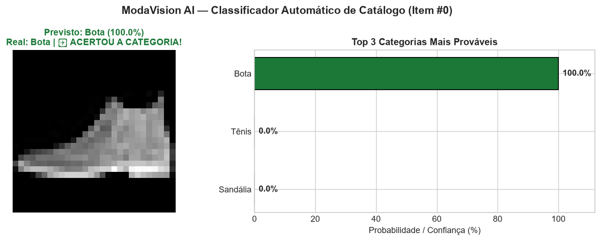

# 👗 ModaVision AI — Classificação Automática de Catálogo de Moda com Deep Learning

**Atividade Prática 4 — NeuroStartup**  
**Disciplina:** Inteligência Artificial e Machine Learning

### 👥 Integrantes do Grupo
- **Allan Reis da Conceição** — RA: 1539160
- **Gabriel Noriler Souza** — RA: 1642714
- **Mayara Franciele Santos da Silva** — RA: 1873454

---

## 🏢 1. O Problema de Negócio e a Solução da ModaVision AI

### O Desafio dos Grandes E-commerces de Moda
Plataformas de e-commerce e marketplaces de moda de grande escala (como **Mercado Livre, Shein, Shopee e Dafiti**) recebem diariamente milhares de novos itens cadastrados manualmente por lojistas parceiros (*sellers*). Esse processo manual gera dois grandes gargalos operacionais:
1. **Alto atrito e lentidão no cadastro:** O vendedor perde tempo navegando em árvores extensas de categorias para classificar cada peça.
2. **Erros de categorização no catálogo:** Produtos cadastrados em categorias erradas (ex.: *camisa* registrada como *camiseta*, ou *bota* registrada como *tênis*) não aparecem nos filtros corretos de busca, reduzindo a conversão de vendas e exigindo equipes caras de auditoria manual.

### Nossa Solução
A **ModaVision AI** desenvolveu um sistema de Visão Computacional baseado em **Redes Neurais Convolucionais (CNN)** em TensorFlow/Keras capaz de identificar automaticamente a categoria de uma peça de vestuário a partir da sua foto, classificando-a instantaneamente entre **10 categorias padronizadas**:
`Camiseta/Top`, `Calça`, `Suéter`, `Vestido`, `Casaco`, `Sandália`, `Camisa`, `Tênis`, `Bolsa` e `Bota`.

---

## 📂 2. Estrutura do Repositório

```text
├── neurostartup.ipynb              # Notebook principal executado do início ao fim (Passos 1 a 4 + Bônus CNN)
├── experimentos.csv                # Registro comparativo de todas as arquiteturas testadas na validação
├── melhor_modelo_modavision.keras  # Melhor modelo treinado e salvo (CNN_ModaVision) pronto para produção
├── MODEL_CARD.md                   # Documentação técnica, ética e limitações do modelo ("bula" do modelo)
├── README.md                       # Documentação geral do projeto e instruções de uso
├── requirements.txt                # Lista de dependências Python para reprodução do ambiente
└── print_tela.png                  # Captura visual do painel de classificação da interface ModaVision AI
```

---

## ⚙️ 3. Como Instalar e Executar o Projeto

### Pré-requisitos
- **Python 3.10 a 3.12** instalado.

### Passo a Passo
1. **Clone este repositório** e acesse a pasta do projeto:
   ```bash
   git clone https://github.com/allanreis01/modavision-ai-neurostartup.git
   cd modavision-ai-neurostartup
   ```

2. **(Opcional, mas recomendado) Crie e ative um ambiente virtual:**
   ```bash
   python -m venv .venv
   # No Windows (PowerShell):
   .\.venv\Scripts\Activate.ps1
   # No Linux/macOS:
   source .venv/bin/activate
   ```

3. **Instale todas as dependências listadas no `requirements.txt`:**
   ```bash
   pip install -r requirements.txt
   ```

4. **Abra e execute o Jupyter Notebook `neurostartup.ipynb`:**
   ```bash
   jupyter notebook neurostartup.ipynb
   ```
   *(Você também pode abrir o arquivo `neurostartup.ipynb` diretamente no **VS Code** com a extensão Jupyter ou no **Google Colab**).*

---

## 📊 4. Resumo dos Resultados e Impacto de Negócio

Seguindo rigorosamente a **Regra do Cofre** (`SEED = 42`), o conjunto oficial de teste (`10.000` imagens) foi mantido isolado até o Passo 3, enquanto o conjunto de desenvolvimento (`60.000` imagens) foi dividido de forma estratificada em **Treino (`48.000`)** e **Validação (`12.000`)**.

### 4.1. Comparação de Arquiteturas na Validação (`experimentos.csv`)
| ID | Modelo | Tipo | Arquitetura Resumida | Parâmetros | Épocas | Acc Treino | Acc Validação | Val Loss |
| :-: | :--- | :--- | :--- | :-: | :-: | :-: | :-: | :-: |
| **5** | **`CNN_ModaVision`** | **Rede Convolucional (CNN - Bônus)** | `Conv2D(32)->Pool->Conv2D(64)->Pool->Flatten->Dense(128)->Dense(10)` | **421.642** | **25** | **96,12%** | **93,13%** | **0,2018** |
| 4 | `MLP_Profunda_256_128_64` | Rede Densa (MLP) | `Dense(256)->Dense(128)->Dense(64)->Dense(10)` + `Dropout(0.2)` | 242.762 | 28 | 92,72% | 89,86% | 0,3029 |
| 3 | `MLP_Media_128_64` | Rede Densa (MLP) | `Dense(128)->Dense(64)->Dense(10)` + `Dropout(0.2)` | 109.386 | 23 | 91,50% | 89,39% | 0,3055 |
| 2 | `MLP_Simples_64` | Rede Densa (MLP) | `Dense(64)->Dense(10)` + `Dropout(0.2)` | 50.890 | 25 | 90,99% | 89,13% | 0,3091 |
| 1 | `Baseline (LogisticRegression)` | Linear (`scikit-learn`) | `Flatten(784) -> Linear(10)` | 7.850 | 1 | 87,69% | 86,12% | — |

### 4.2. Abertura Única do Cofre — Conjunto de Teste (`10.000` imagens inéditas)
| Modelo | Acurácia no Teste (Cofre) | Peças Corretas por 1.000 Cadastros | Erros por 1.000 Cadastros | Redução Relativa de Erro |
| :--- | :-: | :-: | :-: | :-: |
| `Baseline (LogisticRegression)` | 84,27% | 843 | 157 | — |
| **`CNN_ModaVision` (Melhor Modelo)** | **92,27%** | **923** | **77** | **-51,0% de erros** |

> 💼 **Tradução Executiva para o Negócio:**  
> *"A cada **1.000 novos produtos** cadastrados por lojistas na plataforma, o motor **ModaVision AI (`CNN_ModaVision`)** classifica automaticamente **923 peças na categoria correta sem revisão humana** (acurácia de **92,27%** no conjunto de teste), reduzindo os erros de catalogação em **51,0%** em relação ao modelo simples de baseline (queda de **157 para apenas 77 erros** a cada 1.000 cadastros) e direcionando a auditoria humana apenas para peças visualmente ambíguas."*

---

## 🖥️ 5. Interface Interativa do Produto

No Passo 4 do notebook, implementamos a função `classificar_peca(indice_imagem)` integrada a um controle deslizante interativo (`ipywidgets.interact`) que exibe a foto da peça, a categoria prevista com o percentual de confiança, a validação contra o rótulo real e o gráfico de barras horizontais das **Top 3 categorias mais prováveis**:



---

## 🤖 6. Declaração de Uso de Inteligência Artificial

Em conformidade com as diretrizes acadêmicas de transparência e integridade científica da disciplina de **Inteligência Artificial e Machine Learning**, declaramos que o grupo utilizou ferramentas de Inteligência Artificial Generativa (**Google Gemini** e **Antigravity**) como **apoio técnico e pedagógico** durante o desenvolvimento deste projeto, especificamente para:
- Estruturação e organização modular do código em Python/Keras no Jupyter Notebook;
- Revisão da implementação correta de boas práticas de Machine Learning, incluindo a **Regra do Cofre** (isolamento estrito do conjunto de teste), estratificação da validação, configuração de regularização (`Dropout` e `EarlyStopping` com restauração dos melhores pesos) e construção da **Rede Neural Convolucional (CNN)**;
- Padronização visual dos gráficos exploratórios, curvas de aprendizado e formatação da documentação técnica (`README.md` e `MODEL_CARD.md`).

Ressaltamos que **todo o código foi integralmente executado, testado, validado e revisado criticamente pelos três integrantes do grupo**, que compreendem e assumem total responsabilidade pelas decisões técnicas, análises de resultados e conclusões de negócio apresentadas neste repositório.
